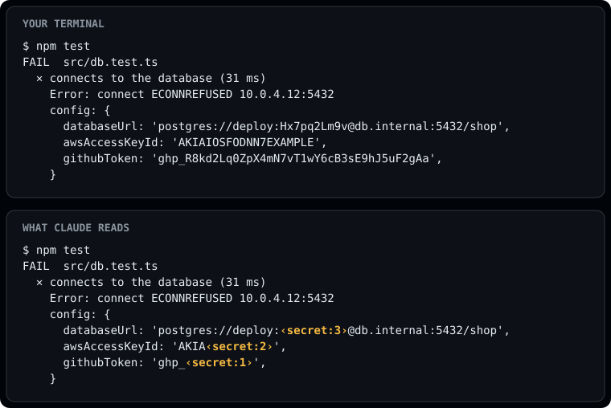

# skills

Plugins and skills for Claude Code. Each entry installs on its own.

```bash
claude plugin marketplace add mashabek/skills
claude plugin install <name>@skills
```

## Plugins

| Plugin | |
|---|---|
| [secret-mask](plugins/secret-mask) | Masks API keys, tokens and passwords in tool output before Claude reads them. Built on the function-hooks API.<br> |
| [projector](plugins/projector) | Plays a video inside a pane beside the chat, with sound: a YouTube link, any yt-dlp URL, or a local file. Real frames where the terminal draws inline images, colored pixel art elsewhere. |

## Skills

Skills are Markdown instructions Claude reads when a task matches. Each one here is wrapped in
its own plugin so it can be installed with the command above.

| Skill | |
|---|---|
| [example-skill](plugins/example-skill) | Template to copy when adding a new skill. Replace before publishing. |

## Layout

```
.claude-plugin/marketplace.json   lists every plugin
plugins/<name>/                   one plugin per entry
  .claude-plugin/plugin.json
  hooks/                          for hook plugins
  skills/<name>/SKILL.md          for skill plugins
```

Adding a skill: copy `plugins/example-skill`, rename the folder, the `name` in its
`plugin.json` and the `skills/<name>` folder to the same value, write the `SKILL.md`, then add an
entry to `marketplace.json` with that same name. Run `claude plugin validate .` before pushing.
